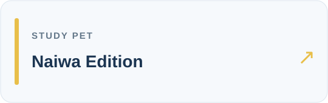

# 你好，我是 Leon 👋

  
  
  
   
  
  

---

齐鲁工业大学光电信息材料与器件专业在读，不是计算机科班，纯业余写代码。课余做了一些校园生活小工具，代码大部分是 AI 帮忙写的，我负责提需求、测试和改 bug。

## 🚀 项目一览

<table>
  <tr>
    <td width="50%" align="center">
      
       
      <b>工大学伴</b> — 图书馆选座 · 入馆码 · 签到提醒 · 空教室查询
       
      
      
    </td>
    <td width="50%" align="center">
      
       
      <b>校园电费</b> — 宿舍电费查询 · 用电统计 · 低余额提醒 · 桌面小组件
       
      
    </td>
  </tr>
  <tr>
    <td width="50%" align="center">
      
       
      <b>工大学伴 · 奶蛙版</b> — 带奶蛙陪学宠物的分支版本
       
      
    </td>
    <td width="50%" align="center">
      
       
      <b>宿舍快开</b> — 本人授权门锁的蓝牙辅助工具
       
      
    </td>
  </tr>
</table>

## 📋 项目详情

| 项目 | 简介 | 平台 | 下载 |
|---|---|---|---|
| [工大学伴](https://github.com/Leon-Cjl/gongda-xueban) | 图书馆选座、入馆提醒与空教室查询 | Android · Windows | [Releases](https://github.com/Leon-Cjl/gongda-xueban/releases) |
| [校园电费](https://github.com/Leon-Cjl/campus-dianfei) | 宿舍电费查询、用电统计与提醒 | Android | [Releases](https://github.com/Leon-Cjl/campus-dianfei/releases) |
| [工大学伴·奶蛙版](https://github.com/Leon-Cjl/gongda-xueban-naiwa) | 带奶蛙陪学小屋的安卓版本 | Android | [Releases](https://github.com/Leon-Cjl/gongda-xueban-naiwa/releases) |
| [宿舍快开](https://github.com/Leon-Cjl/dorm-native-open) | 面向本人已获授权的蓝牙门锁的辅助工具 | Android | [Releases](https://github.com/Leon-Cjl/dorm-native-open/releases) |

## ⚖️ 免责声明

> 这些项目由个人开发，与齐鲁工业大学及相关平台**无官方关联**。服务、数据和使用规则以官方系统为准。所有应用仅限本人账号使用，不得代约、转让或倒卖。宿舍快开需本人有效授权和兼容的门锁，尚未完成全部真实环境验证。

## 🔧 关于开发

不是程序员，纯业余。代码大部分靠 Claude、Codex、Gemini 和 DeepSeek 写的，我负责提需求、测试和修 bug。有问题欢迎在 Issues 里提。
